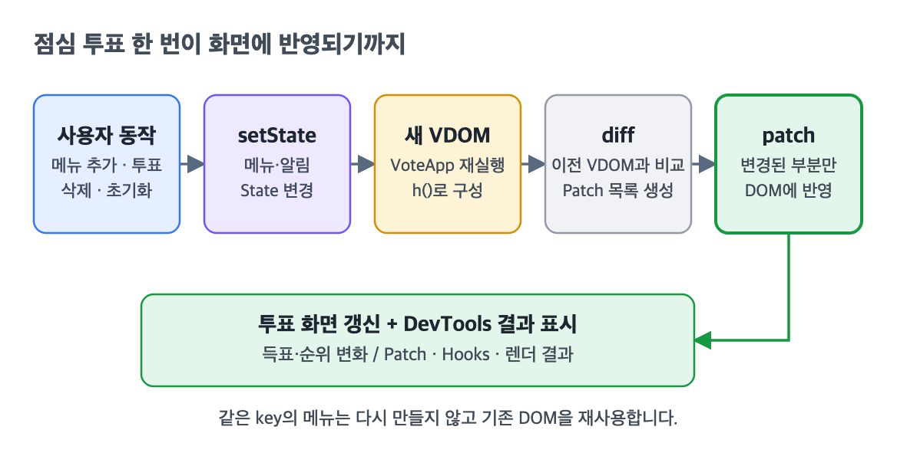
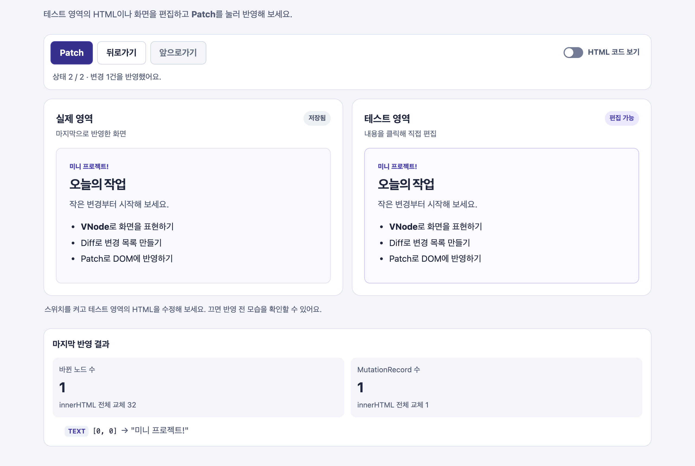
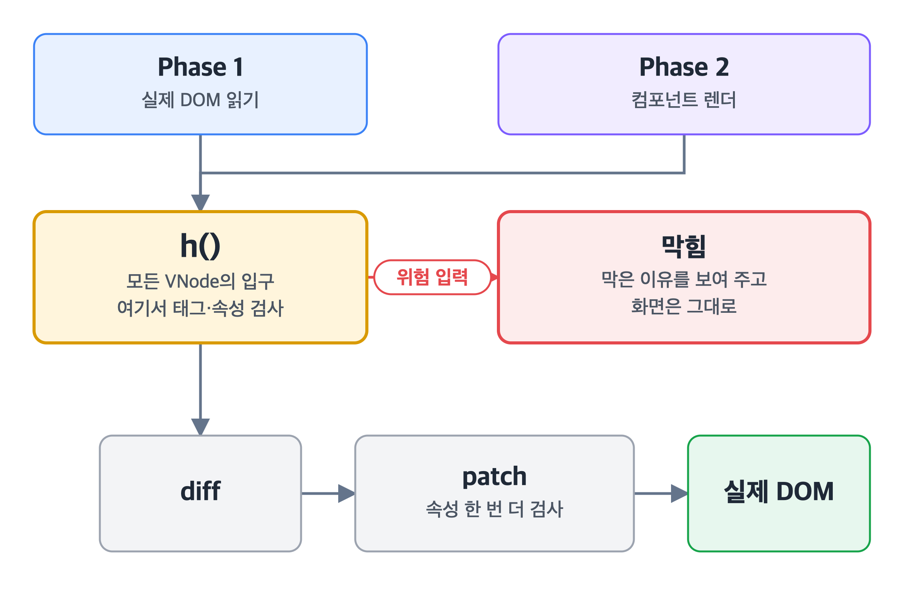
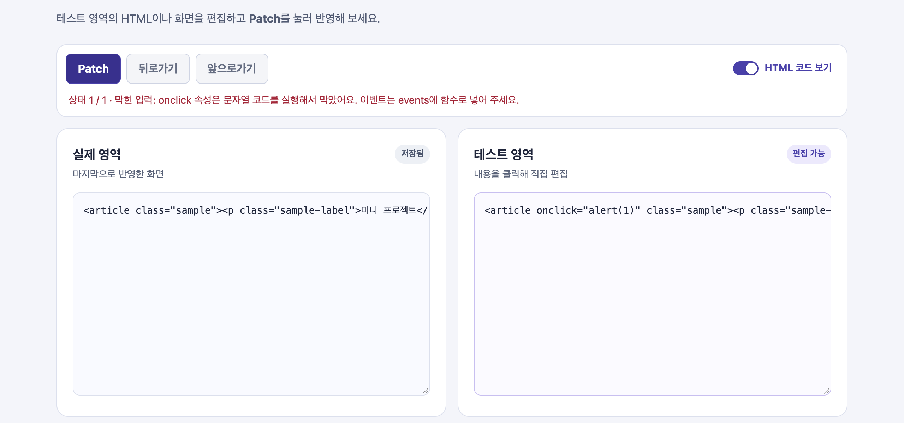
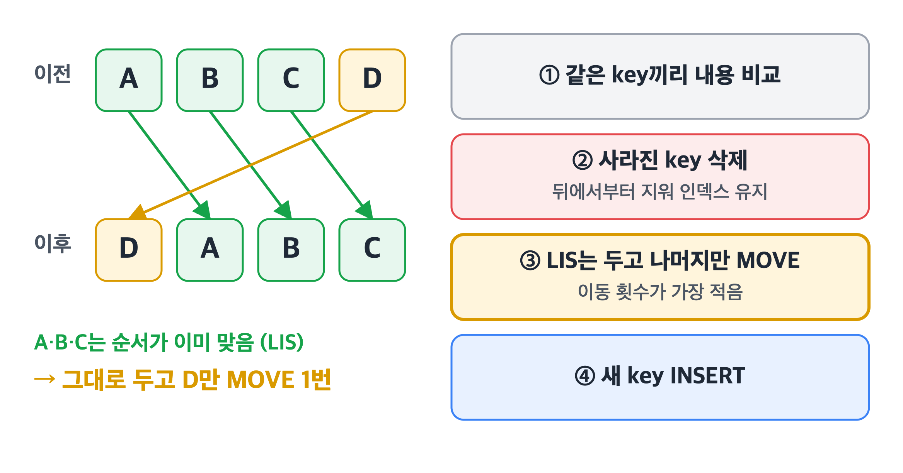
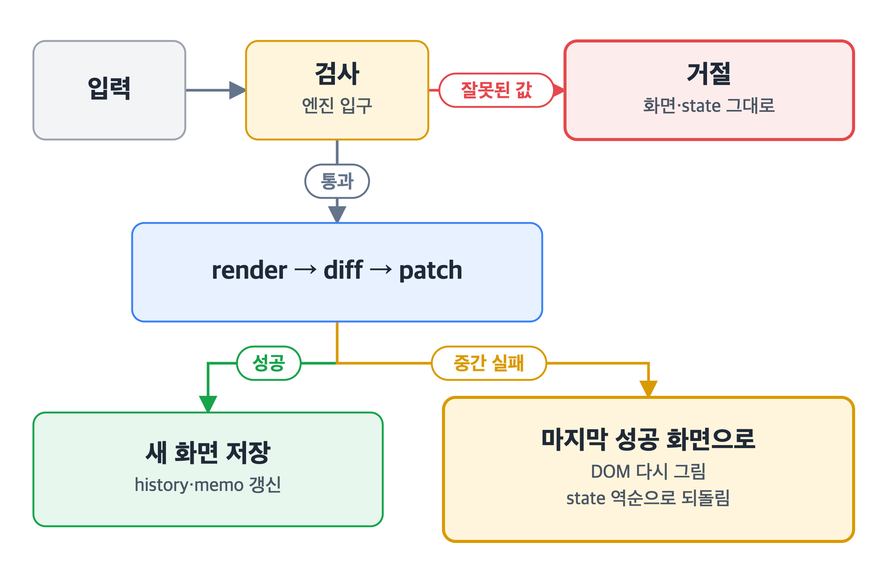
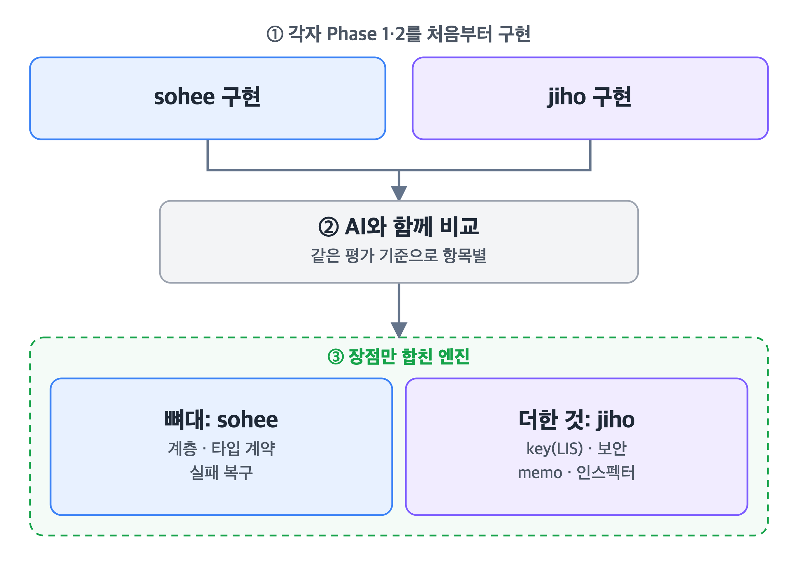

<div align="center">

# JS 미니 리액트 발표


-7.0.2-3178C6?logo=typescript&logoColor=white)


프레임워크 없이 **Vanilla JavaScript로 만든 미니 리액트**입니다. 두 사람이 각자 만든 구현을 하나로 합쳤습니다.

</div>

## 동작 흐름



시작하는 방법만 다르고, 그 뒤 **VDOM → diff → patch는 두 Phase가 같은 코드를 씁니다.**



## 폴더 구조

```text
src/
  core/        엔진 핵심: h() · 보안 검사 · diff · history
  dom/         실제 DOM에 그리고(render) 바뀐 곳만 고침(patch)
  component/   FunctionComponent · useState · useEffect · useMemo · batch
  app/         데모 페이지 · Patch 로그 · Hooks 인스펙터
tests/
  unit/        모듈별 테스트
  integration/ 화면 동작 테스트
docs/          설계 문서 · 평가 기준 · 병합 계획
```

## 차별점 1 · 보안: 입구 하나에서 막습니다



화면이 만들어지는 길은 두 개지만, **둘 다 `h()`를 지납니다.** 그래서 검사를 `h()` 한 곳에 두었습니다. patch에서도 속성을 한 번 더 확인합니다.

- `onclick` 같은 **문자열 이벤트 속성** → 막음
- `href="javascript:..."` 같은 **스크립트 URL** → 막음 (`java\tscript:` 우회도 막음)
- `script` · `iframe` 같은 **위험 태그** → 막음



## 차별점 2 · Batching: setState 여러 번, 렌더는 한 번

```js
component.batch(() => { setCount(c => c + 1); setCount(c => c + 1); setCount(c => c + 1); }); // 렌더 3번 → 1번
```

`batch()` 안의 setState를 모아 두었다가 **한 번에 적용하고, 렌더도 한 번만** 합니다.

## 차별점 3 · key: 다시 만들지 않고 옮깁니다

key가 없으면 같은 위치끼리 비교합니다. 그래서 **맨 앞에 하나만 넣어도 뒤의 항목이 전부 바뀐 것처럼** 보입니다.

| 5개 목록에서 | key 없음 | key 있음 |
| --- | --- | --- |
| 맨 앞에 추가 | 수정 5 + 추가 1 | **추가 1** |
| 순서 뒤집기 | 수정 4 | **이동 4** (기존 노드 재사용) |



형제 **전부에 서로 다른 key가 있을 때만** key로 짝짓습니다. 순서가 이미 맞는 노드(LIS)는 그대로 두고, **나머지만 옮겨서 이동 횟수를 최소로** 만듭니다.

## 차별점 4 · 복구: 실패해도 마지막 화면은 지킵니다



- **잘못된 값은 입구에서 거절**: 위험 입력, hook 순서 변경, 렌더 중 setState
- **처리 중 실패하면 되돌림**: 트리 밖 Patch처럼 반영 도중 막히면 DOM은 마지막 성공 화면으로, state는 바뀌기 전 값으로
- **성공했을 때만 저장**: history와 memo 캐시

## 실제 React와 비교

| | 우리 구현 | 실제 React |
| --- | --- | --- |
| Batching | `batch()`로 감싼 곳만 묶음 | React 18(`createRoot`)부터 어디서든 **자동으로** 묶음 [^batch] |
| key | LIS로 **옮길 노드를 최소로** 고름 | 앞에서부터 훑으며 옮길 노드를 고름 [^reconcile] |
| 렌더 오류 | **마지막 성공 화면으로 복구** | Error Boundary가 없으면 **화면 전체를 내림** [^error] |

[^batch]: [React v18.0: Automatic Batching](https://react.dev/blog/2022/03/29/react-v18#new-feature-automatic-batching)
[^reconcile]: [facebook/react `ReactChildFiber.js`](https://github.com/facebook/react/blob/main/packages/react-reconciler/src/ReactChildFiber.js)
[^error]: [Error Boundaries (React 16 문서)](https://legacy.reactjs.org/docs/error-boundaries.html#new-behavior-for-uncaught-errors), [Catching rendering errors with an error boundary](https://react.dev/reference/react/Component#catching-rendering-errors-with-an-error-boundary)

## 협업: 각자 만들고, 좋은 것만 합쳤습니다



1. **각자 끝까지 만들었습니다.** 두 사람 모두 Phase 1·2를 처음부터 구현해서 VDOM, diff, hooks를 직접 이해했습니다.
2. **AI와 함께 비교했습니다.** 같은 평가 기준으로 두 구현을 항목별로 비교했습니다. 구조가 달라 파일째 섞을 수 없어서, 한쪽을 뼈대로 정했습니다.
3. **장점만 합쳤습니다.** sohee 구현의 탄탄한 구조와 복구 위에 jiho 구현의 key·보안·memo를 다시 구현했습니다.

그 결과 **서로의 빈 곳이 채워졌습니다.** jiho 구현의 자식 state는 과제 규칙에 맞게 빼고, sohee 구현에 없던 자식 hook 차단은 새로 넣었습니다.

## 테스트: 228개 모두 통과

| 기능 | 꼭 지켜야 하는 경우 |
| --- | --- |
| diff | 여러 개를 지울 때 뒤에서부터 지워 순서가 안 꼬임 |
| key | 순서를 바꾸면 노드를 다시 만들지 않고 옮김 |
| patch | 중간에 실패하면 남은 작업을 멈춤 |
| 보안 | 컴포넌트에서 만든 화면도 같은 규칙으로 막음 |
| batch | setState 3번이 렌더 1번으로 줄어듦 |
| batch 복구 | 묶음 처리가 실패하면 DOM과 state를 함께 되돌림 |
| hooks | 렌더 중 오류가 나도 화면과 state를 지킴 |
| history | 반영이 실패해도 뒤로·앞으로 가기 기록을 지킴 |

> 개념 설명, 실행 방법, 자세한 구현은 [이전 README](docs/OLD_README.md)에 있습니다.
