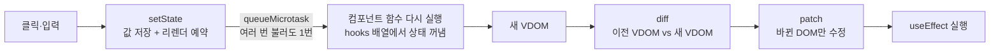

# Mini React

프레임워크 없이 Vanilla JS로 만든 미니 리액트입니다. Virtual DOM, Diff, Patch 엔진(Phase 1) 위에 함수형 컴포넌트와 Hooks(Phase 2)를 올렸습니다.

- **Phase 1**: 실제 DOM → VDOM 변환, 두 VDOM 비교(diff), 바뀐 곳만 반영(patch), 뒤로·앞으로 가기
- **Phase 2**: `h()`, `FunctionComponent`, `useState` · `useEffect` · `useMemo`, batching, 이벤트 위임
- **차별점**: key 기반 리스트 재조정(LIS), memo + 같은 참조 건너뛰기, Hooks 인스펙터

## 실행

```bash
npm install
```

```bash
npm test
```

```bash
python3 -m http.server 5517
```

- Phase 1 검증 페이지: http://localhost:5517/phase1/
- Phase 2 데모(할 일 앱 + Hooks 인스펙터): http://localhost:5517/app/
- ES Module을 쓰기 때문에 `file://`로는 열 수 없고, 로컬 서버가 필요합니다.

## 동작 흐름



- Phase 1에서는 사람이 textarea를 고치고 Patch 버튼을 눌러 이 흐름의 뒷부분(VDOM → diff → patch)을 돌렸습니다.
- Phase 2에서는 setState가 Patch 버튼을, 컴포넌트 함수가 textarea를 대신합니다. diff와 patch는 그대로 재사용합니다.

## 폴더 구조

```
src/
  types.js       VNode·Patch 계약, diff 출력 순서 규칙
  vdom.js        DOM/HTML ↔ VNode, createElement
  diff.js        diff(old, new) → patches  (+ key 재조정, 같은 참조 건너뛰기)
  patch.js       patch(container, patches) (+ MOVE, value·checked 동기화)
  history.js     뒤로/앞으로 가기용 VNode 기록
  component.js   h, memo, FunctionComponent, useState, useEffect, useMemo, 이벤트 위임
phase1/          Phase 1 검증 페이지
app/             Phase 2 데모: App.js(컴포넌트) · main.js(mount + 인스펙터)
tests/           Vitest + jsdom 단위·통합·기능 테스트
docs/            일정(SCHEDULE.md), 개념 정리(CONCEPTS.md)
```

## Phase 1: Virtual DOM, Diff, Patch

### DOM 조작이 느린 이유

- DOM API 호출 자체가 느린 것은 아닙니다. 호출 뒤에 따라오는 **Reflow**(위치·크기 다시 계산)와 **Repaint**(픽셀 다시 칠하기)가 비쌉니다.
- 노드 추가·삭제, 글자 변경은 Reflow를 일으키고, 바뀐 요소의 부모·형제·자식까지 다시 계산될 수 있습니다.
- 그래서 실제 DOM을 건드리는 횟수를 줄이는 것이 VDOM의 목적입니다.

### Virtual DOM

- 실제 DOM 트리를 같은 모양의 가벼운 JS 객체 트리로 옮긴 것입니다.
- 엘리먼트 `{ type, props, children }`, 텍스트 `{ type: '#text', text }`
- 객체를 만들고 비교하는 일은 메모리 안에서 끝나 Reflow가 생기지 않습니다. 비교 결과(바뀐 곳)만 실제 DOM에 반영합니다.

### Diff: 같은 위치끼리 위에서부터 비교

| 상황 | patch | 실제 DOM API |
| --- | --- | --- |
| 새 노드만 있음 | CREATE | `insertBefore(createElement(v), ref)` |
| 이전 노드만 있음 | REMOVE | `remove()` |
| 태그 종류가 다름 | REPLACE | `replaceWith(createElement(v))` |
| 텍스트 내용이 다름 | TEXT | `nodeValue = text` |
| 속성이 다름 | PROPS | `setAttribute` / `removeAttribute` |

- 자식은 같은 인덱스끼리 재귀로 비교합니다.
- 같은 부모의 노드 여러 개를 지울 때는 뒤에서부터 지워야 앞 인덱스가 밀리지 않습니다.

### DOM 변화 감지: MutationObserver

- 실제 DOM이 바뀔 때마다 기록(MutationRecord)을 남기는 브라우저 API입니다.
- 검증 페이지와 데모는 이것으로 "patch가 DOM을 몇 번 바꿨는지"를 세어 innerHTML 전체 교체와 비교합니다.
- 예: 할 일 글자 하나와 제목 class만 바꿨을 때 바뀐 노드 수는 diff → patch 2개, innerHTML 전체 교체 26개입니다.

## Phase 2: Component, State, Hooks

### 함수는 매번 다시 실행되는데, 상태는 어떻게 유지할까?

- 상태를 함수 안(지역 변수)이 아니라 함수 바깥, 즉 `FunctionComponent` 인스턴스의 `hooks` 배열에 둡니다.
- 렌더를 시작할 때 `hookIndex`를 0으로 되돌리고, hook을 부를 때마다 `hooks[hookIndex++]` 칸을 씁니다.
- 매 렌더 같은 순서로 hook을 부르므로 같은 칸을 다시 만납니다. 그래서 조건문 안에서 hook을 쓰면 안 됩니다.

```
렌더 1: useState('') → hooks[0]   useState('all') → hooks[1]   useMemo(...) → hooks[2]
렌더 2: useState('') → hooks[0]   ← 초기값은 무시하고 저장된 값을 꺼냄
```

### setState가 상태 변경 말고 하는 일

1. **값 저장**: hooks 배열의 자기 칸을 고칩니다. 같은 값(`Object.is`)이면 여기서 끝납니다.
2. **리렌더 예약**: 바로 그리지 않고 `queueMicrotask`로 미룹니다. 핸들러 안에서 여러 번 불러도 첫 번째만 예약하므로 **렌더는 한 번**입니다(batching).

### 컴포넌트 분리와 state 위치

- 화면에서 한 가지 역할을 맡는 덩어리로 나눴습니다: `Header`, `TodoForm`, `Toolbar`, `TodoList`, `TodoItem`
- state는 그것을 쓰는 컴포넌트들의 가장 가까운 공통 부모에 둡니다. 과제 제약에 따라 모든 state는 루트 `App`에 있고, 자식은 props만 받는 순수 함수입니다(Lifting State Up).
- 자식에서 hook을 부르거나, 렌더 밖에서 hook을 부르거나, hook 개수·순서가 바뀌면 **에러를 던져** 이 규칙을 코드로 강제합니다.

### 그 밖의 구현

- `useEffect`: patch가 끝난 뒤 실행합니다. deps가 같으면 건너뛰고, 다시 실행하기 전과 `unmount()` 때 cleanup을 부릅니다.
- `useMemo`: deps가 같으면 지난번 값을 그대로 돌려줍니다. 자식에게 넘기는 핸들러 묶음을 같은 객체로 유지하는 데도 씁니다.
- 이벤트 위임: 컨테이너 하나에 이벤트 종류별로 리스너를 한 번만 답니다. 이벤트가 오면 클릭된 위치로 **지금** VNode를 찾아 그 핸들러를 부르므로 오래된 클로저 문제가 없습니다.
- controlled input: 입력 후에는 `value` 속성이 화면에 영향을 주지 않으므로, patch가 `el.value` 프로퍼티도 함께 씁니다. 한글 조합(IME) 중에 값을 다시 쓰면 조합이 끊길 수 있어서, 값이 같으면 쓰지 않습니다.

## 차별점: 엔진이 더 적게 일하게

### 1. key 기반 리스트 재조정 (LIS)

- 위치로 짝짓는 diff는 목록 맨 앞에 하나만 넣어도 뒤의 모든 항목을 "글자가 바뀜"으로 봅니다.
- 형제 전부에 key가 있으면 같은 key를 같은 노드로 보고, 노드를 **지우지 않고 옮깁니다**(`MOVE` patch 추가).
- 가장 긴 증가 부분수열(LIS)에 든 노드는 순서가 이미 맞으므로 그대로 두고 나머지만 옮깁니다. 그래서 MOVE 개수가 최소가 됩니다.

| 4개 목록에서 | 위치 비교 | key 비교 |
| --- | --- | --- |
| 맨 앞에 추가 | TEXT 4 + CREATE 1 | CREATE 1 |
| 맨 앞 항목을 맨 뒤로 | TEXT 4 | MOVE 1 |
| 순서 뒤집기 | TEXT 4 | MOVE 3 (기존 노드 4개 재사용) |

### 2. memo + 같은 참조 건너뛰기

- `memo(Component)`는 props가 얕은 비교로 같으면 함수를 부르지 않고 **지난번 VNode 객체**를 그대로 돌려줍니다.
- diff 첫 줄은 `if (a === b) return;`입니다. 같은 객체면 하위 트리 비교를 통째로 건너뜁니다.
- 자식이 순수 함수라는 과제 제약 덕분에 안전합니다. 같은 props면 같은 화면이 나옵니다.
- 결과: 입력창에 타이핑하는 동안 할 일 항목은 함수 호출 0번, diff 0번입니다. patch는 input의 value 1개입니다. 첫 글자에서만 추가 버튼의 disabled 해제가 더해져 2개입니다.

### 3. Hooks 인스펙터

- 데모 오른쪽에 hooks 배열(칸 번호, 종류, 값, deps)을 실시간으로 보여 주고, 이번 렌더에서 바뀐 칸을 표시합니다.
- 렌더 번호, 묶인 setState 수, memo로 건너뛴 자식 수, patch 종류별 개수, MutationRecord 수도 함께 보여 줍니다.
- 인스펙터 자체도 미니 리액트로 그립니다.

## 실제 React와의 차이

| 이번 구현 | 실제 React |
| --- | --- |
| state는 루트 컴포넌트 하나에만 | 컴포넌트마다 자기 state (Fiber 노드마다 hooks 연결 리스트) |
| 렌더를 한 번에 끝까지 재귀 (중간에 멈출 수 없음) | Fiber로 작업을 쪼개 멈추고 이어서 함 |
| batching = `queueMicrotask` 한 번 | React 18부터 출처와 상관없이 자동 batching, 우선순위 스케줄링 [^batch] |
| `useEffect`를 patch 직후 동기로 실행 | 보통 화면을 그린 뒤 실행. 클릭 같은 입력의 결과면 그리기 전에 실행될 수 있음 [^effect] |
| 이벤트: 컨테이너 위임 + 원본 이벤트 객체 | React 17부터 루트 컨테이너 위임 + 합성 이벤트 [^events] |
| key 재조정: LIS로 MOVE 최소화 | 앞에서부터 훑으며, 이전 위치가 지금까지 둔 노드의 위치(lastPlacedIndex)보다 앞이면 이동 [^reconcile] |
| 속성은 문자열만, `style` 객체·SVG 미지원 | DOM 프로퍼티, style 객체, SVG 네임스페이스 처리 |

[^batch]: [React v18.0: Automatic Batching](https://react.dev/blog/2022/03/29/react-v18), [Queueing a Series of State Updates](https://react.dev/learn/queueing-a-series-of-state-updates)
[^effect]: [useEffect](https://react.dev/reference/react/useEffect), [useLayoutEffect](https://react.dev/reference/react/useLayoutEffect)
[^events]: [React v17.0: Changes to Event Delegation](https://legacy.reactjs.org/blog/2020/10/20/react-v17.html)
[^reconcile]: [facebook/react `ReactChildFiber.js`의 placeChild](https://github.com/facebook/react/blob/main/packages/react-reconciler/src/ReactChildFiber.js)

## 테스트

`npm test` 결과: 12개 파일, 251개 테스트가 통과합니다.

| 파일 | 확인하는 것 |
| --- | --- |
| `vdom` · `diff` · `patch` · `history` · `integration` · `edge` · `fixtures` · `editor` · `log` | Phase 1 엔진과 검증 페이지 (198개) |
| `component.test.js` | h, useState, batching, 이벤트 위임, useEffect, useMemo, memo, hook 규칙, unmount (29개) |
| `keyed.test.js` | key 재조정의 patch 개수와 노드 재사용, 무작위 300회 fuzz, LIS (14개) |
| `app.test.js` | 데모 앱의 추가·체크·삭제·필터·batching·뒤집기·저장 (10개) |

## 과제 요구사항 대응

| 요구사항 | 구현 위치 |
| --- | --- |
| DOM → VDOM 변환, diff 5가지 케이스, 바뀐 부분만 patch | `src/vdom.js`, `src/diff.js`, `src/patch.js` |
| 실제 영역 · 테스트 영역 · Patch / 뒤로가기 / 앞으로가기 | `phase1/` |
| 함수형 컴포넌트, `FunctionComponent`(hooks · mount · update) | `src/component.js` |
| hook과 state는 루트에서만, 자식은 stateless | `app/App.js`, 위반 시 에러 (`component.test.js`) |
| state 변경 시 VDOM → diff → patch 재사용 | `FunctionComponent.update()` |
| `useState` · `useEffect` · `useMemo` | `src/component.js` |
| Batching (선택) | `scheduleUpdate()` |
| 데모 페이지: 입력·클릭에 따른 부분 업데이트 | `app/` |
| 모듈별 단위 테스트, 기능 테스트, 엣지 케이스 | `tests/` |
