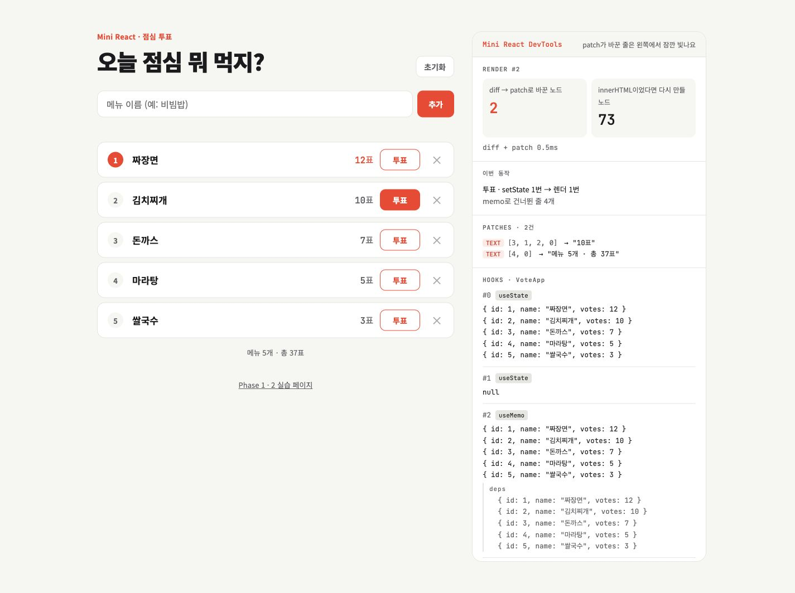

# JS 미니 리액트 발표

프레임워크 없이 **Vanilla JavaScript로 만든 미니 리액트**입니다.

## 동작 흐름

메뉴를 추가하거나 투표하면 **State → VDOM → diff → patch**를 거쳐 화면이 바뀌고, DevTools에서 결과를 확인할 수 있습니다.

## 실제 데모 · 점심메뉴 투표

---

## 차별점

### 01 · 보안 — 입구 하나에서 막습니다

Phase 1과 Phase 2 모두 `h()`를 거치므로, 공통 보안 검사를 통해 위험한 태그와 속성을 차단하고 기존 화면을 유지하도록 구현했습니다.

### 02 · key — 다시 만들지 않고 옮깁니다

| 5개 목록에서 | key 없음 | key 있음 |
| --- | --- | --- |
| 맨 앞에 추가 | 수정 5 + 추가 1 | **추가 1** |
| 순서 뒤집기 | 수정 4 | **이동 4** (기존 노드 재사용) |

key로 각 항목을 식별하고, LIS 알고리즘을 이용해 이미 순서가 맞는 노드는 유지하며 필요한 노드만 이동시킵니다.

---

## 협업 과정

**각자 만들고, 좋은 것만 합쳤습니다.**

저희는 두 명이 각각 Phase 1과 Phase 2를 모두 구현했습니다.

이후 AI를 활용해 두 구현을 동일한 기준으로 비교했고, 구조가 달라 단순히 파일을 합치는 대신 한쪽 구조를 기준으로 장점을 다시 구현했습니다.

이 과정에서 서로의 부족한 부분을 보완하면서 안정성과 성능을 개선할 수 있었습니다.
