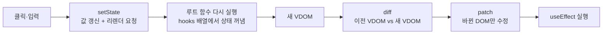

# Mini React

프레임워크 없이 Vanilla JavaScript(ESM + JSDoc 타입 검사)로 만든 미니 리액트입니다. Virtual DOM, Diff, Patch 엔진(Phase 1) 위에 함수형 컴포넌트와 Hooks(Phase 2)를 올렸습니다. 이 저장소는 두 팀원의 구현(`sohee-phase2`, `jiho-phase2`)을 하나로 합친 결과입니다.

- **Phase 1**: 실제 DOM → VDOM 변환, 두 VDOM 비교(diff), 바뀐 곳만 반영(patch), 뒤로·앞으로 가기
- **Phase 2**: `FunctionComponent`, `useState` · `useEffect` · `useMemo`, `batch()`, 루트 전용 Hook 규칙
- **차별점**: key 기반 리스트 재조정(LIS), memo와 같은 값 건너뛰기, 실패하면 마지막 화면으로 복구, 엔진 전체에 걸친 위험 입력 차단, Patch 로그와 innerHTML 비용 비교, Hooks 인스펙터

## 실행

Node.js 지원 범위는 `package.json`의 `engines`에 있습니다.

```bash
npm ci
```

```bash
npm run dev
```

| 경로 | 페이지 |
| --- | --- |
| `/` | Phase 1 검증 페이지: 실제 영역, 테스트 영역, Patch·뒤로가기·앞으로가기, Patch 로그 |
| `/todo.html` | Phase 2 할 일 앱 + Hooks 인스펙터 |

| 명령 | 용도 |
| --- | --- |
| `npm test` | Vitest 전체 실행 |
| `npm run typecheck` | JS/JSDoc 계약 정적 검사 |
| `npm run check` | 정적 검사 후 전체 테스트 |

## 동작 흐름



Phase 1에서는 사람이 테스트 영역을 고치고 Patch 버튼을 눌러 이 흐름의 뒷부분(VDOM → diff → patch)을 돌립니다. Phase 2에서는 setState가 Patch 버튼을, 루트 컴포넌트 함수가 테스트 영역을 대신합니다. diff와 patch는 그대로 재사용합니다.

## 폴더 구조

```text
src/
  core/        contracts.js(타입 계약) · vnode.js(h) · security.js(위험 입력 차단) · diff.js(key·LIS) · history.js
  dom/         from-dom.js(DOM → VNode) · render.js(VNode → DOM) · patch.js(MOVE 포함) · events.js
  component/   function-component.js(FunctionComponent, useState·useEffect·useMemo, child, batch)
  app/         main.js(Phase 1 페이지) · todo.js · patch-report.js · inspector.js
index.html     Phase 1 검증 페이지
todo.html      Phase 2 할 일 + Hooks 인스펙터
docs/          architecture.md · PHASE2_SPEC.md · CONCEPTS.md · SCHEDULE.md · EVALUATION.md · MERGE_PLAN.md
```

## Phase 1: Virtual DOM, Diff, Patch

### DOM 조작이 느린 이유

DOM API 호출 자체가 느린 것은 아닙니다. 호출 뒤에 따라오는 **Reflow**(위치·크기 다시 계산)와 **Repaint**(픽셀 다시 칠하기)가 비쌉니다. 노드를 추가·삭제하거나 글자를 바꾸면 Reflow가 생기고, 바뀐 요소의 부모·형제·자식까지 다시 계산될 수 있습니다. 그래서 실제 DOM을 건드리는 횟수를 줄이는 것이 VDOM의 목적입니다.

### Virtual DOM

실제 DOM 트리를 같은 모양의 가벼운 JS 객체 트리로 옮긴 것입니다.

```js
{ kind: 'element', tag: 'li', props: { attrs: { class: 'done' }, events: {} }, children: [...], key: '3' }
{ kind: 'text', value: '장보기' }
```

객체를 만들고 비교하는 일은 메모리 안에서 끝나 Reflow가 생기지 않습니다. 비교 결과(바뀐 곳)만 실제 DOM에 반영합니다. DOM을 VDOM으로 읽을 때는 화면에 보이지 않는 노드를 버립니다.

- 주석은 버리고, 주석 양옆의 텍스트는 하나로 합칩니다.
- 줄바꿈이 들어간 공백만 있는 텍스트는 들여쓰기이므로 버립니다. 띄어쓰기만 있는 텍스트는 화면에 보이므로 남깁니다.
- `<pre>`, `<textarea>` 안의 공백은 내용이므로 손대지 않습니다.

실제 영역도 같은 규칙으로 정리해 두기 때문에(`normalizeDOM`) 화면의 `childNodes` 순서와 VNode의 `children` 순서가 항상 같습니다.

### Diff: 같은 위치끼리 위에서부터 비교

| 상황 | Patch | 실제 DOM API |
| --- | --- | --- |
| 새 노드만 있음 | `INSERT` | `insertBefore(createDOM(v), anchor)` |
| 이전 노드만 있음 | `REMOVE` | `remove()` |
| 태그 종류가 다름 | `REPLACE` | `replaceWith(createDOM(v))` |
| 텍스트 내용이 다름 | `TEXT` | `text.data = value` |
| 속성·이벤트가 다름 | `PROPS` | `setAttribute` / `removeAttribute` / `add·removeEventListener` |
| key 목록의 순서만 바뀜 | `MOVE` | `insertBefore(기존 노드, anchor)` |

자식은 같은 인덱스끼리 재귀로 비교합니다. 같은 부모의 노드 여러 개를 지울 때는 뒤에서부터 지워야 앞 인덱스가 밀리지 않습니다. 모든 Patch 경로는 바로 앞 Patch까지 적용한 DOM을 기준으로 합니다.

### DOM 변화 감지: MutationObserver

MutationObserver는 실제 DOM이 바뀔 때마다 기록(MutationRecord)을 남기는 브라우저 API입니다. Phase 1 페이지는 이것으로 "patch가 DOM을 몇 번 바꿨는지"를 세어, 같은 변경을 innerHTML로 통째로 바꿨을 때와 나란히 보여 줍니다. 예를 들어 제목 글자 하나를 바꾸면 patch는 노드 1개, innerHTML 전체 교체는 32개를 바꿉니다.

## Phase 2: Component, State, Hooks

### 함수는 매번 다시 실행되는데, 상태는 어떻게 유지할까?

상태를 함수 안(지역 변수)이 아니라 함수 바깥인 `FunctionComponent` 인스턴스의 `hooks` 배열에 둡니다. 렌더를 시작할 때 슬롯 위치를 0으로 되돌리고, hook을 부를 때마다 다음 칸을 씁니다. 매 렌더 같은 순서로 hook을 부르므로 같은 칸을 다시 만납니다. 그래서 조건문 안에서 hook을 쓰면 안 되고, 순서가 바뀌면 엔진이 오류를 냅니다.

```text
렌더 1: useState(초기 목록) → hooks[0]   useState('all') → hooks[1]   useMemo(...) → hooks[2]   useEffect(...) → hooks[3]
렌더 2: useState(초기 목록) → hooks[0]   ← 초기값은 무시하고 저장된 값을 꺼냄
```

### setState가 상태 변경 말고 하는 일

setState는 값만 바꾸지 않고 **리렌더를 요청**합니다. 단, 지금과 같은 값이면 요청하지 않습니다. 루트 함수를 다시 실행해 새 VDOM을 만들고, 이전 VDOM과 diff한 뒤 바뀐 곳만 patch합니다. Patch가 실패하면 슬롯 값과 화면을 마지막으로 성공한 상태로 되돌립니다. 여러 setState를 한 번의 렌더로 묶고 싶으면 `component.batch()` 안에서 부릅니다. Effect 안에서 부른 setState는 큐에 넣었다가 Effect가 모두 끝난 뒤 차례로 반영하고, 연속 50번을 넘으면 무한 갱신으로 보고 멈춥니다.

### 컴포넌트 분리와 state 위치

화면에서 한 가지 역할을 맡는 덩어리로 나눴습니다(`TodoForm`, `TodoFilters`, `TodoList`). 상태는 루트 `TodoApp`에만 두고, 자식은 props로 값과 핸들러를 받아 VNode를 돌려주는 순수 함수입니다(Lifting State Up). 자식은 `child(Component, props)`로 실행하는데, 이때 자식이 hook을 부르면 엔진이 오류를 냅니다.

### 그 밖의 구현

- `useEffect`: DOM 반영이 끝난 뒤 실행합니다. deps가 같으면 건너뛰고, 다시 실행하기 전과 `unmount()` 때 cleanup을 부릅니다. cleanup 하나가 실패해도 나머지를 모두 실행한 뒤 오류를 전달합니다.
- `useMemo`: deps가 같으면 지난번 값을 그대로 돌려줍니다. 새 값은 DOM 반영에 성공한 뒤에만 캐시에 넣습니다.
- 이벤트: VNode의 `events`에 함수를 담고, patch가 노드별로 `addEventListener`/`removeEventListener`를 관리합니다(WeakMap 기록).

## 차별점

### 1. key 기반 리스트 재조정 (LIS)

위치로 짝짓는 diff는 목록 맨 앞에 하나만 넣어도 뒤의 모든 항목을 "글자가 바뀜"으로 봅니다. 형제 전부에 key가 있으면 같은 key를 같은 노드로 보고, 노드를 **지우지 않고 옮깁니다**(`MOVE`). 가장 긴 증가 부분수열(LIS)에 든 노드는 순서가 이미 맞으므로 그대로 두고 나머지만 옮기기 때문에 MOVE 개수가 최소가 됩니다. 할 일 목록은 항목 id를 key로 씁니다.

| 5개 목록에서 | 위치 비교 | key 비교 |
| --- | --- | --- |
| 맨 앞에 추가 | TEXT 5 + INSERT 1 | INSERT 1 |
| 순서 뒤집기 | TEXT 4 | MOVE 4 (기존 노드 재사용) |

### 2. memo와 같은 값 건너뛰기

state는 루트에만 있으므로 무엇이 바뀌든 루트부터 다시 실행됩니다. 그래서 바뀌지 않은 자식을 걸러 내는 일이 중요합니다.

- `memo(Component)`로 감싼 자식을 `child()`로 부르면, 루트의 기록장에서 지난번 props와 결과를 찾습니다. 찾을 때는 key를 쓰고, key가 없으면 몇 번째 호출인지를 씁니다. props가 얕은 비교로 같으면 함수를 부르지 않고 **지난번 VNode 객체**를 그대로 돌려줍니다. diff 첫 줄이 `before === after`이므로 그 아래 비교를 통째로 건너뜁니다.
- 기록장은 커밋에 성공했을 때만 바꿉니다. 이번에 부르지 않은 자식의 기록은 이때 버려집니다.
- 핸들러처럼 함수를 props로 넘기면 `useMemo`로 같은 함수를 유지해야 합니다. 렌더마다 새 함수를 만들면 props가 늘 달라 보여서 하나도 건너뛰지 못합니다.
- `setState`에 지금과 같은 값(`Object.is`)을 넣으면 렌더·diff·patch를 하지 않습니다. 이미 "전체"인 필터를 또 눌러도 아무 일도 일어나지 않습니다.
- 할 일 4개 중 하나를 체크하면 바뀐 1줄만 다시 실행되고 3줄은 건너뜁니다(인스펙터에 표시).

### 3. 실패하면 마지막 화면으로 복구

Patch는 하나씩 적용하기 직전에 경로·노드 종류·값을 검사합니다. 중간에 실패하면 Phase 1 페이지와 `FunctionComponent` 모두 마지막으로 성공한 VNode로 화면을 되돌리고, 이력과 상태도 이전 값으로 유지합니다.

### 4. Patch 로그와 innerHTML 비용 비교

Phase 1 페이지 아래에 방금 적용한 Patch 목록과, MutationObserver로 센 "patch가 바꾼 노드 수 vs innerHTML 전체 교체" 수를 보여 줍니다.

### 5. Hooks 인스펙터

할 일 페이지 오른쪽에 hooks 배열(칸 번호, 종류, 값, deps)과 렌더 번호, memo로 건너뛴 자식 수, 이번 렌더의 Patch 목록을 보여 줍니다. 인스펙터 자체도 미니 리액트로 그립니다(`FunctionComponent.onCommit`).

## 보안: 위험한 입력은 엔진 한 곳에서 막기

모든 VNode는 `h()`를 거쳐 만들어집니다. Phase 1에서 DOM을 읽을 때도(`domToVNode`), Phase 2 컴포넌트가 화면을 그릴 때도 같은 `h()`를 지나므로 `src/core/security.js`의 규칙 하나로 두 경로를 함께 막습니다. 렌더(`createDOM`)와 Patch(`PROPS`)도 같은 함수로 한 번 더 검사합니다.

| 막는 것 | 이유 |
| --- | --- |
| `onclick`·`ONERROR` 같은 `on*` 문자열 속성 | 문자열 코드가 인라인 핸들러로 실행됩니다. 이벤트는 `events`에 함수로 넣습니다 |
| `href`·`src`·`action`·`formaction`·`xlink:href`·`data`의 `javascript:` URL | 클릭·로드 때 스크립트가 실행됩니다. 브라우저처럼 앞의 제어문자와 중간의 탭·줄바꿈을 무시하고 검사합니다(`java\tscript:`도 막음) |
| `script`·`style`·`iframe`·`object`·`embed`·`base`·`link`·`meta` 태그 | 스크립트를 실행하거나 문서 밖 자원·설정을 끌어옵니다 |

막히면 `UnsafeInputError`가 나고, Phase 1 페이지는 "막힌 입력: 이유"를 상태 표시줄에 보여 준 뒤 저장된 화면으로 되돌립니다.

VDOM 공백 규칙에도 한계가 있습니다. `<b>a</b>` 줄바꿈 `<i>b</i>`처럼 인라인 요소 사이의 줄바꿈 공백도 버리므로 화면의 "a b"가 "ab"로 붙습니다. `white-space: pre`를 CSS로 준 요소는 태그 이름만 보고 판단하므로 보존하지 않습니다.

막지 않는 것도 있습니다. `style` 속성은 문자열로 받으므로 사용자 값을 넣으면 CSS 주입이 가능하고, `data:` URL과 `srcdoc`은 검사하지 않습니다. 페이지에 CSP도 없습니다.

## 실제 React와의 차이

| 이번 구현 | 실제 React |
| --- | --- |
| 루트 하나만 hooks 배열을 갖고, 자식은 상태 없는 함수. memo 기록도 루트에 둠 | 컴포넌트마다 Fiber 노드(hooks 연결 리스트) |
| 렌더를 한 번에 끝까지 재귀 (중간에 멈출 수 없음) | Fiber로 작업을 쪼개 멈추고 이어서 함 |
| `batch()`로 명시한 구간만 묶음 | React 18부터 이벤트 출처와 상관없이 자동 batching [^batch] |
| `useEffect`를 patch 직후 동기로 실행 | 보통 화면을 그린 뒤 실행 [^effect] |
| 노드마다 리스너를 붙이고 WeakMap으로 기록 | 루트 컨테이너 하나에 위임 + 합성 이벤트 [^events] |
| key 재조정: LIS로 MOVE 최소화 | 앞에서부터 훑으며 lastPlacedIndex로 이동 여부를 정함 [^reconcile] |
| 속성은 문자열만, `style` 객체·SVG 미지원 | DOM 프로퍼티, style 객체, SVG 네임스페이스 처리 |

[^batch]: [React v18.0: Automatic Batching](https://react.dev/blog/2022/03/29/react-v18), [Queueing a Series of State Updates](https://react.dev/learn/queueing-a-series-of-state-updates)
[^effect]: [useEffect](https://react.dev/reference/react/useEffect)
[^events]: [React v17.0: Changes to Event Delegation](https://legacy.reactjs.org/blog/2020/10/20/react-v17.html)
[^reconcile]: [facebook/react `ReactChildFiber.js`](https://github.com/facebook/react/blob/main/packages/react-reconciler/src/ReactChildFiber.js)

## 두 구현을 합친 방식

두 사람의 구현은 VNode 모양, Patch 형식, 공백 규칙이 달라서 모듈 단위로 섞을 수 없었습니다([평가 기준](docs/EVALUATION.md), [평가와 병합 계획](docs/MERGE_PLAN.md)). 그래서 한쪽 계약을 뼈대로 정하고 다른 쪽 기능을 그 위에 다시 구현했습니다.

**sohee 구현을 뼈대로 고른 이유**

- 과제 제약("Hook은 루트에서만, 자식은 순수 함수")에 맞는 단순한 구조였습니다. jiho 구현의 자식 인스턴스 기능은 이 제약을 지키려면 어차피 걷어내야 했습니다.
- `core`·`dom`·`component`로 계층이 나뉘어 있고, JSDoc + `tsc`로 계약을 검사합니다.
- Patch 직전 검사, 실패 복구, Effect 오류 모으기, 무한 갱신 상한처럼 오류를 다루는 부분이 이미 갖춰져 있었습니다.
- jiho 쪽 강점(key·LIS·MOVE, memo, 같은 값 건너뛰기, 엔진 전체 보안 규칙, Patch 로그, Hooks 인스펙터)은 계약을 크게 바꾸지 않고 옮겨 붙일 수 있었습니다.

## 트러블슈팅: 자식 컴포넌트도 state를 쓰게 해 봤다가 되돌린 이유

**상황.** 과제는 "state는 루트에만 두고 자식은 props만 받는다"는 제약을 둡니다. 그런데 입력창 글자처럼 한 컴포넌트만 쓰는 작은 상태까지 루트로 올리면, props를 여러 단계 내려보내야 하고 글자 하나를 칠 때마다 루트부터 다시 실행됩니다.

**시도.** `jiho-phase2` 브랜치(커밋 `cc59c45`)에서 React처럼 자식 컴포넌트마다 상자(인스턴스)를 만들어 자기 `hooks` 배열을 갖게 했습니다. 자식 상자는 key로, key가 없으면 "같은 부모 안에서 같은 컴포넌트를 몇 번째로 불렀나"로 지난번 상자와 짝지었습니다. setState는 그 상자만 다시 실행하고, 루트까지 가는 길의 VNode만 복사해 루트부터 diff했습니다. 부모가 더 이상 부르지 않는 상자는 화면에서 빠진 것으로 보고 cleanup을 부른 뒤 버렸습니다.

**문제.**

- 과제 제약을 벗어납니다. 평가 기준의 "hook은 루트에서만" 항목에서 감점 대상이었습니다.
- 상자 짝짓기, 바뀐 자식의 VNode 위치 찾기(트리를 따라가는 O(N) 탐색), 복사한 조상 VNode를 상자 기록에 다시 연결하는 일까지 엔진이 떠안게 되어, 컴포넌트 모듈이 520줄을 넘었습니다.
- 반대로 sohee 구현은 자식 hook을 막지 않아서, 자식이 `useState`를 부르면 그 칸이 루트의 hooks 배열에 조용히 섞여 들어갔습니다.

**해결.** 합친 엔진은 자식을 `child(Component, props)`로 실행하고, 그동안 hook 호출을 오류로 막습니다. 자식은 props만 받는 순수 함수로 두고, 작은 상태도 루트에 둡니다. 루트가 다시 실행되는 비용은 `memo`와 key 재조정으로 줄입니다. memo는 상태가 아니라 "지난번 props와 결과" 캐시라서 자식 인스턴스 없이 루트의 기록장에 둘 수 있습니다. 남은 한계도 있습니다. `TodoForm(props)`처럼 `child()` 없이 직접 호출하면 루트 몸체와 구분할 수 없어 막지 못합니다.

## 테스트

`npm test`: 25개 파일, 228개 테스트가 통과합니다. `npm run typecheck`도 통과합니다.

| 위치 | 확인하는 것 |
| --- | --- |
| `tests/unit` | vnode, from-dom, diff, patch, render, history, useState, useEffect, useMemo, batch, todo-controls |
| `tests/integration` | 엔진 왕복, 이력, Phase 1 페이지(복구·여러 루트·미래 이력 분기), 컴포넌트 마운트·갱신·Effect·batch·memo, 할 일 데모 |
| `tests/integration/team-merge.test.js` | 병합으로 더한 기능: key INSERT·MOVE와 노드 재사용, Phase 1·2 공통 위험 입력 차단, 자식 hook 차단, 주석 초안 반영, 막힌 입력 이유 표시, onCommit 순서와 오류 격리, memo 건너뛰기, 같은 값 setState |

## 과제 요구사항 대응

| 요구사항 | 구현 위치 |
| --- | --- |
| DOM → VDOM 변환, diff 5가지 케이스, 바뀐 부분만 patch | `src/dom/from-dom.js`, `src/core/diff.js`, `src/dom/patch.js` |
| 실제 영역 · 테스트 영역 · Patch / 뒤로가기 / 앞으로가기 | `index.html`, `src/app/main.js` |
| 함수형 컴포넌트, `FunctionComponent`(hooks · mount · update) | `src/component/function-component.js` |
| hook과 state는 루트에서만, 자식은 props만 받는 순수 함수 | `child()`가 자식 실행 중 hook 호출을 막음 |
| state 변경 시 VDOM → diff → patch 재사용 | `FunctionComponent`의 commit |
| `useState` · `useEffect` · `useMemo` | `src/component/function-component.js` |
| Batching (선택) | `component.batch()` |
| 데모 페이지: 입력·클릭에 따른 부분 업데이트 | `todo.html` (최종 데모는 별도 주제로 예정) |
| 모듈별 단위 테스트, 기능 테스트, 엣지 케이스 | `tests/` |

## 문서

- [데이터 구조·인터페이스·의존성](docs/architecture.md) · [Phase 2 설계 계약](docs/PHASE2_SPEC.md) · [JSDoc 계약](src/core/contracts.js)
- [개념 정리](docs/CONCEPTS.md) · [일정](docs/SCHEDULE.md) · [구현 계획](PLAN.md) · [AI 작업 지침](AGENTS.md)
